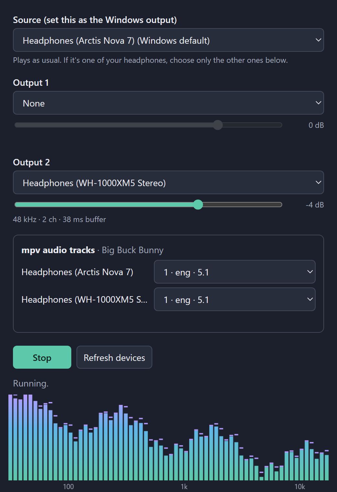

# Audio Splitter

A small Windows app that plays your computer's sound on more than one pair of headphones or speakers at once. Built with Rust and Tauri.

Windows plays sound on one device at a time. If two people want to watch a movie on one computer with their own headphones, only one of them hears it. Audio Splitter fixes that.



## What it's for

- **Watching together with two pairs of headphones:** you and a friend watch a movie or a show late at night without disturbing anyone. Both of you hear everything the computer plays.
- **Watching in two languages at once:** one person listens to the original soundtrack and the other to a dubbed version, while you both watch the same video in [mpv](https://mpv.io). The second track stays in sync with the picture through pauses and seeks.
- **Sending sound to two places at once:** for example, your headphones and a TV, or a speaker in another room.

Each output has its own volume, so a quiet pair of headphones can be turned up without changing the other.

## How it works

You keep using your computer as usual: apps play to one device, the **source**. The app listens to what the source is playing and repeats it, in real time, on up to two other devices. It corrects for devices running at slightly different speeds, so they don't drift apart over a long movie.

For two languages, the app reads the audio tracks of the video open in mpv and starts a second, hidden mpv that plays the other track on the other headphones. It copies your pauses and seeks to that mpv and keeps the two within a few hundredths of a second of each other.

The window also shows a live frequency spectrum of the sound.

## Requirements

- Windows 10 or 11
- For a different track per listener: mpv, available as `mpv` on the `PATH`

### Headphones

Any headphones or speakers that Windows lists as a sound output work: wired, USB or Bluetooth, and any brand. Each pair needs its own connection to the computer, so two wired pairs need two outputs, such as the headphone jack and a USB headset or USB sound adapter.

- **Bluetooth:** most computers can connect two Bluetooth headphones at once, but some adapters struggle, which shows up as dropouts. A USB headset with its own wireless dongle avoids this. Bluetooth headphones also add their own delay. When copying the source, a Bluetooth output lags a wired one, which is easier to notice with two Bluetooth pairs of different models.
- **Headsets with a microphone:** while an app uses the microphone, Windows can switch a Bluetooth headset to low-quality call audio. Close apps that use the microphone, such as Discord or Teams, or choose the headset's stereo output if Windows lists it separately.
- **Two identical models:** both pairs get the same name in Windows, so you can't tell them apart in the app. Give one a different name in **Settings → System → Sound**, under the device's properties.

To build it, you also need Rust and the Tauri CLI:

```bash
cargo install tauri-cli --version "^2"
```

## Build

```bash
cd src-tauri
cargo tauri build --no-bundle
```

The app is built at `src-tauri/target/release/audio-splitter.exe`.

## Usage

### Same sound on two headphones

1. In **Settings → System → Sound → Output**, select the first headphones.
2. Open the app. **Source** defaults to the Windows output device.
3. Choose the second headphones as **Output 2**, leave **Output 1** as **None**, and click **Start**.

### A different audio track for each listener

One-time setup: add this line to `%APPDATA%\mpv\mpv.conf`, so the app can talk to mpv:

```
input-ipc-server=mpv-audio-splitter
```

Then play the video as usual, for example `mpv video.mkv`. An **mpv audio tracks** panel appears in the app with a track picker for each pair of headphones.

When an output's track differs from the source's, the app starts a hidden mpv that plays that track of the same file on that output, and keeps it in sync with yours:

- **Pause and seek:** copied right away.
- **Drift:** corrected by playing up to 3% faster or slower, with mpv keeping the pitch.

In tests it stays within about 10–25 ms of the main mpv. Picking the same track for everyone goes back to copying the source.

Your selections and volumes are remembered. If an output was selected last time, the app starts automatically on launch.

## Features

- **Volume per output:** from muted to +12 dB, remembered per device and adjustable during playback. Boosting can clip loud audio.
- **Mismatched devices:** handles different sample rates, channel counts and device clocks.
- **Spectrum display:** shows 30 Hz to 18 kHz, while the source is being copied.

## Limitations

- Copied outputs play about 40 ms behind the source, and more if the app has to recover from glitches. Each device's own latency adds to that: a Bluetooth output lags further behind a wired one.
- While outputs play their own tracks, they don't hear other apps, and the spectrum is blank.
- Only one mpv at a time can be followed.
- If a device disconnects, reconnect it, click **Refresh devices**, then **Stop** and **Start**.
- An output can't be the source device, and both outputs can't be the same device.

## Development

```bash
cd src-tauri
cargo test --lib
```

Checks on real devices:

- `examples/e2e.rs` checks the audio copying path. It plays a quiet test tone that can be audible, so choose devices that aren't routed to speakers.
- `examples/follow_sync.rs` measures how closely a hidden mpv follows the main one through play, seek, pause and speed changes, silently. Its doc comment explains how to run it.
